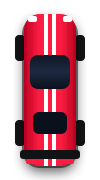

# 🏎️ Speed Rush – 2D Arcade Car Racing Game by adiinnovation.com

A fast-paced, visually attractive **2D endless highway car racing game** built strictly with **HTML5 Canvas**, **CSS3**, and **Vanilla JavaScript** (zero external frameworks, zero Node.js/Python dependencies, zero paid APIs).



---

## 🚀 How to Run the Game Locally

### Option 1: Direct Browser Launch (Easiest)
1. Open the project folder: `C:\Users\DELL\.gemini\antigravity\scratch\speed-rush`
2. Double-click **`index.html`** to launch it directly in Google Chrome, Microsoft Edge, Mozilla Firefox, or Safari.
3. The game will run **100% offline** without needing any server, build step, or installation!

### Option 2: Local Server (Optional)
If you prefer running via a local web server:
- **PowerShell (Built-in script)**: Run `powershell -ExecutionPolicy Bypass -File run-server.ps1` and navigate to `http://localhost:8080/`.
- **VS Code Live Server**: Right-click `index.html` and choose **"Open with Live Server"**.

---

## 🎮 Game Controls

### 💻 Desktop Controls
| Key | Action |
| :--- | :--- |
| **`←` / `A`** | Steer Sports Car Left |
| **`→` / `D`** | Steer Sports Car Right |
| **`Spacebar`** | Start race / Resume race / Restart after crash |
| **`P` / `Esc`** | Pause & Pit Stop / Resume |
| **`M`** | Toggle Sound (Mute / Unmute) |
| **Left / Right Click** | Tap left or right half of highway to steer |

### 📱 Mobile & Tablet Controls
- **On-Screen `LEFT` / `RIGHT` Buttons**: Ergonomic circular thumb buttons located at the bottom corners.
- **Direct Screen Tapping**: Tap and hold the left or right side of the highway directly on the screen.
- **Header Buttons**: Dedicated **Mute** (`🔊`/`🔇`) and **Pause** (`⏸`) icons at the top right of the screen.

---

## 🌟 Key Features

1. **Start Screen & Garage**: High-tech neon arcade interface displaying your high score, game instructions, and an interactive car color selector.
2. **Three-Lane Highway**: Asphalt textured highway with continuous scrolling dashed divider lines, alternating red-and-white rumble curbs, roadside metal guardrails, and passing trees and streetlamps.
3. **Player Sports Car**: Sleek aerodynamic chassis with dual racing stripes, tinted windshield, rear spoiler, dynamic steering tilt, and glowing xenon headlights illuminating the road ahead.
4. **Varied Enemy Traffic**: Spawns sports cars, city sedans, classic yellow taxis, heavy muscle cars, and delivery vans in distinct vivid colors and realistic relative speeds.
5. **Fair Collision & Spawning**: Intelligent multi-lane algorithm ensures at least one lane is always passable; inset hitboxes ensure near-miss thrills without unfair ghost collisions.
6. **Animated Gold Coins**: 3D spinning collectable coins with golden sparkle effects and `+100` floating score indicators.
7. **Dynamic Speed Progression**: As your distance score increases, vehicle speed accelerates from 110 KM/H up to 250 KM/H with animated "SPEED UP!" alerts.
8. **Real-time Heads-Up Display (HUD)**:
   - Current Score (distance + coin bonuses)
   - Real-time Speedometer (digital readout + animated tri-color LED gauge bar)
   - Coins Collected
   - All-time Best Score
9. **Persistent High Scores**: Best score and selected car color are saved locally via `localStorage`.
10. **Procedural Web Audio Engine**: Zero-asset sound synthesizer creating continuous engine rumble (pitch scales with vehicle speed), coin pickup chimes, deep crash explosions, level up fanfares, and crisp UI clicks.

---

## 🛠️ Customization Guide

All gameplay parameters, graphics, and rules are consolidated in the **`CONFIG`** object at the top of [`script.js`](file:///C:/Users/DELL/.gemini/antigravity/scratch/speed-rush/script.js#L23-L85).

### 1. Customizing Car Colors
Open [`script.js`](file:///C:/Users/DELL/.gemini/antigravity/scratch/speed-rush/script.js) and locate `CONFIG.player` and `CONFIG.enemies`:

```javascript
// Change default player car color
CONFIG.player.defaultColor = '#00d2ff'; // Switch to electric cyan
CONFIG.player.stripeColor  = '#ffff00'; // Yellow racing stripes

// Add or edit enemy car models and colors
CONFIG.enemies.types = [
  { name: 'supercar', width: 46, height: 86, color: '#00d2ff', accent: '#ffffff', type: 'sport' },
  { name: 'taxi',     width: 44, height: 82, color: '#ffd000', accent: '#000000', type: 'taxi' },
  { name: 'hotrod',   width: 48, height: 88, color: '#ff0055', accent: '#ffffff', type: 'muscle' },
];
```

You can also add new color chips to the start screen in [`index.html`](file:///C:/Users/DELL/.gemini/antigravity/scratch/speed-rush/index.html#L61-L67):
```html
<button class="color-chip" data-color="#ff00ff" style="--chip-color: #ff00ff;" title="Neon Magenta"></button>
```

### 2. Tuning Speed & Handling
Modify `CONFIG.player` in [`script.js`](file:///C:/Users/DELL/.gemini/antigravity/scratch/speed-rush/script.js):
```javascript
player: {
  startSpeed: 120,        // Higher initial speed (KM/H)
  maxSpeed: 280,          // Maximum top speed limit (KM/H)
  speedIncreaseRate: 5.0, // Acceleration boost added per milestone
  steerSpeed: 440,        // Faster, more responsive steering (px/second)
  tiltAngleMax: 0.15,     // More aggressive car tilt on turns (radians)
}
```

### 3. Modifying Road & Highway Design
Modify `CONFIG.road` in [`script.js`](file:///C:/Users/DELL/.gemini/antigravity/scratch/speed-rush/script.js):
```javascript
road: {
  lanes: 3,               // Number of lanes (e.g. 3 or 4)
  width: 320,             // Total highway width in pixels
  asphaltColor: '#1a1b20',// Darker stealth asphalt
  asphaltInner: '#22242a',// Center gradient
  kerbRed: '#e52525',     // Rumble curb color 1
  kerbWhite: '#ffffff',   // Rumble curb color 2
  dividerColor: '#ffff00',// Yellow lane markings instead of white
}
```

### 4. Adjusting Difficulty & Traffic Spawn
Modify `CONFIG.enemies` and `CONFIG.difficulty`:
```javascript
enemies: {
  minSpawnInterval: 0.8, // Shorter interval = denser traffic (Harder)
  maxSpawnInterval: 1.6, 
  speedVariance: [0.45, 0.80], // Enemies drive between 45% and 80% player speed
}

coins: {
  spawnChance: 0.70,     // 70% chance to spawn coins with each wave
  scoreValue: 200,       // Award 200 points per coin
}

difficulty: {
  scoreIntervalForSpeedUp: 300, // Speed up every 300 points instead of 400
}
```

---

## 📁 Project File Structure

```text
speed-rush/
│
├── index.html            # Main game HTML5 structure, HUD & modal overlays
├── style.css             # Cyberpunk/arcade dark theme, responsive styling, HUD
├── script.js             # Game engine, Web Audio synth, canvas rendering & physics
├── run-server.ps1        # Optional lightweight localhost test server
├── README.md             # Documentation, controls & customization guide
└── assets/
    ├── images/
    │   └── car-icon.svg  # High-res vector racer icon & browser favicon
    └── sounds/
        └── readme.txt    # Audio synthesizer architecture notes
```

---

## 🏆 Tips for High Scores
- **Stay in the Center Lane**: The middle lane gives you quick escape options to both left and right lanes.
- **Watch Headlights Ahead**: Enemy headlights emerge at the top of the screen before the car chassis fully enters.
- **Grab Every Coin**: Each coin is worth `+100` distance points and accelerates your journey to new records!
